<h1 align="center">Licenciatura en Sistemas, UNLP</h1>

## Primer año

### Segundo semestre

  <a href="https://github.com/alvaroauth/Taller-De-Programacion">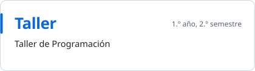</a>
  <a href="https://github.com/alvaroauth/ARQUI">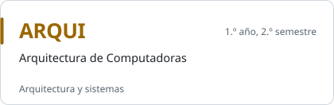</a>

## Segundo año

### Primer semestre

  <a href="https://github.com/alvaroauth/AyED">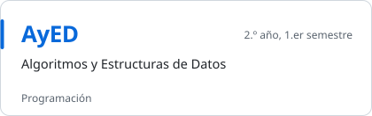</a>
  <a href="https://github.com/alvaroauth/FOD">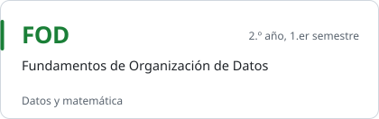</a>
  
  
  <a href="https://github.com/alvaroauth/ProyectoDotNet-Segunda-Entrega">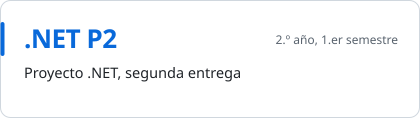</a>

### Segundo semestre

  
  <a href="https://github.com/alvaroauth/INGE-1">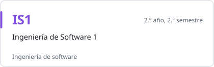</a>
  <a href="https://github.com/alvaroauth/OO1">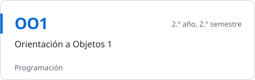</a>
  <a href="https://github.com/alvaroauth/DBD">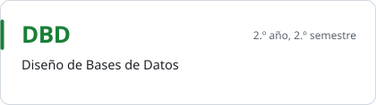</a>

## Tercer año

### Primer semestre

  <a href="https://github.com/alvaroauth/INGE-2">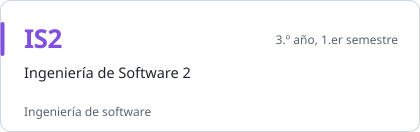</a>
  <a href="https://github.com/alvaroauth/OO2">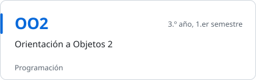</a>
  <a href="https://github.com/alvaroauth/CPLP">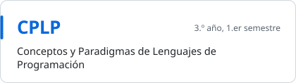</a>
  <a href="https://github.com/alvaroauth/MATE-3">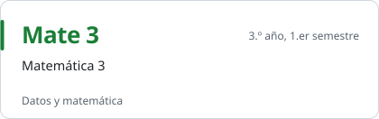</a>

### Segundo semestre

  
  <a href="https://github.com/alvaroauth/PdS">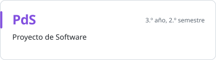</a>
  <a href="https://github.com/alvaroauth/RyC">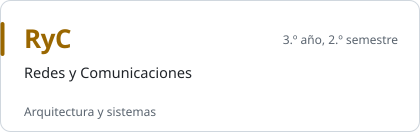</a>
  

